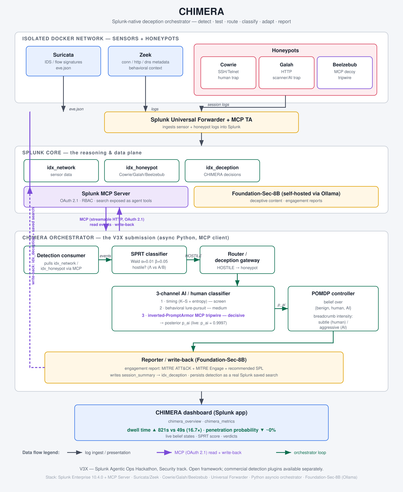

# CHIMERA — Architecture

CHIMERA is a Splunk-native AI deception agent. It watches live sensor and honeypot
data through the **Splunk MCP Server**, decides whether traffic is hostile with a
*provable* error bound, works out whether the intruder is a human or an autonomous
AI agent, and adapts its deception to maximize attacker dwell time while keeping the
probability of a real breach near zero. Every decision is written back to Splunk —
and the generated detection is persisted as a real saved search.

This document supersedes the earlier scaffold stub. It describes **what was actually
built and live-verified**, not an aspirational design.



---

## 1. Layered system

CHIMERA is six layers; the MCP Server is the spine connecting the orchestrator to
Splunk for both reads and write-back.

1. **Sensor layer.** Suricata (IDS / flow signatures, `eve.json`) and Zeek
   (conn/http/dns metadata) — eyes, not a brain. *(Topology note: in the single-host
   Docker setup Suricata cannot see intra-bridge Cowrie traffic, so the real signal
   during an SSH attack lands in `idx_honeypot`, not `idx_network`.)*
2. **Honeypot layer.** Cowrie (SSH/Telnet — the human trap), Galah (HTTP — the
   scanner/AI trap, LLM-generated responses), and **Beelzebub** (the **MCP decoy** that
   provides the tripwire). All three live on an isolated Docker network (`chimera_dmz`).
3. **Ingestion.** A Splunk **Universal Forwarder** (matched build 10.4.0) ships sensor
   and honeypot logs into Splunk. It runs as `splunkfwd` with
   `CAP_DAC_READ_SEARCH` so it can read root-owned Docker volume logs without running
   as root.
4. **Splunk core.** Three indexes — `idx_network` (sensors), `idx_honeypot`
   (Cowrie/Galah/Beelzebub), `idx_deception` (CHIMERA's own decisions) — plus the
   **Splunk MCP Server** app (MCP TA 1.2.0), which exposes search as agent-callable
   tools over streamable HTTP with OAuth 2.1 bearer auth.
5. **Orchestrator (the V3X submission).** An async Python 3.12 service that is an
   **MCP client**: it reads events through MCP, runs the math, and writes decisions
   back. This is `orchestrator/chimera/`.
6. **Presentation.** The CHIMERA Splunk app: `chimera_overview` (live loop) and
   `chimera_metrics` (the dwell-time money chart, penetration gauge, live belief table).

## 2. The agent loop (six steps)

The orchestrator (`orchestrator/chimera/loop.py`) runs one async loop per process:

```
detect → SPRT test → route → classify (human vs AI) → adapt (POMDP) → Foundation-Sec report → write-back
```

1. **Detect.** Poll `idx_network` / `idx_honeypot` through the MCP client
   (`mcp_client.py`: `splunk_run_query`, `splunk_get_indexes`). Parse each event into a
   typed evidence record (`sprt.classify_event`, which reaches into `_raw` JSON because
   the MCP server only auto-extracts a few KV fields).
2. **SPRT test.** Feed evidence into the per-`src_ip` SPRT state (`sprt.py`). On the
   first crossing of a Wald bound the verdict becomes sticky (HOSTILE or BENIGN).
3. **Route.** On the HOSTILE transition the router/deception gateway (`router.py`)
   decides which honeypot to steer the source to (SSH-shaped → Cowrie:2222;
   web/scanner-shaped → Galah:8080; tie → Cowrie) and records the decision.
4. **Classify.** Per session, the three-channel classifier (`classifier.py` +
   `channel_timing.py`, `channel_behavioral.py`, `channel_tripwire.py`) fuses signals
   into a posterior `p_ai`.
5. **Adapt.** The POMDP belief controller (`pomdp.py`) Bayesian-updates a belief over
   `{benign, human, AI}` from the SPRT verdict and `p_ai`, then a threshold policy picks
   breadcrumb intensity and emits a `deception_action` event.
6. **Report + write-back.** On session end (`finalize.py`), Foundation-Sec-8B
   (`reporter.py`) generates the engagement report; CHIMERA writes a `session_summary`
   to `idx_deception` (`deception_writer.py`) and persists the generated SPL as a real
   Splunk saved search (`saved_search.py`).

The controllers never raise into the loop: routing, belief-writes, reporting and
saved-search creation are all best-effort and logged on failure so a single hiccup
can't stall detection.

## 3. The math layers

### 3.1 SPRT — sequential detection with provable error bounds *(mandatory)*

Wald's Sequential Probability Ratio Test accumulates a log-likelihood ratio
`Λ = Σ log( P(evidence | hostile) / P(evidence | benign) )` over a stream of events.
Each evidence type carries a fixed log-LR (e.g. `cowrie.login.success` = +2.0,
`cowrie.session.file_download` = +2.5, `port_scan_signature` = +2.5, ordinary
`normal_http` = −0.5). Decision rule:

- **HOSTILE** when `Λ ≥ A`, with `A = ln((1−β)/α) ≈ +4.554`.
- **BENIGN** when `Λ ≤ B`, with `B = ln(β/(1−α)) ≈ −2.986`.
- Otherwise **UNDECIDED** — keep collecting evidence.

With **α = 0.01** (false-positive) and **β = 0.05** (false-negative), the Wald bounds
guarantee those error rates *by construction* — this is the "provable" claim, and the
key differentiator from an opaque ML score. Verdicts are sticky per `src_ip`
(first crossing wins, Λ frozen) and confidence is mapped from Λ vs the crossed bound.
*Live-verified:* `src_ip 172.30.0.1` reached HOSTILE at **Λ=5.7**, confidence 1.0.

### 3.2 Three-channel AI/human classifier *(mandatory)*

Once a source is held in a honeypot, CHIMERA classifies *who* it's holding. Three
independent channels fuse into `p_ai`:

- **Timing** (`channel_timing.py`) — a Kolmogorov–Smirnov test against a human
  inter-command-interval reference distribution plus Shannon entropy of the intervals.
  Machine cadence is near-uniform / low-entropy; humans are bursty.
- **Behavioral** (`channel_behavioral.py`) — lure-pursuit divergence: how
  single-mindedly the session chases planted goals (credential-looking files, "next
  step" breadcrumbs) versus exploring like a person.
- **MCP tripwire** (`channel_tripwire.py`) — **the wedge.** This inverts PromptArmor
  (a prompt-injection *defense*) into a *sensor*: the **Beelzebub MCP decoy** advertises
  a tool no human would ever invoke (e.g. an account-manager tool). A human at a shell
  never sees or calls it; an LLM agent enumerates and calls it — and fingerprints
  itself as AI. This channel is decisive when it fires.

*Live-verified:* the AI session was classified **AI at p_ai = 0.9997**, decided by the
tripwire; the human session was judged human.

### 3.3 POMDP belief controller *(simplified for v1)*

The adaptive-deception brain (`pomdp.py`) is a small POMDP, **not** deep RL:

- **Hidden state** `{benign, human, AI}`; **belief** `b` is a 3-vector on the simplex,
  one per `src_ip`/session, started from a benign-heavy prior `[0.8, 0.1, 0.1]`.
- **Bayesian update** `b'(s) ∝ P(obs | s) · b(s)`, renormalized, numerically stable.
  Two cleanly separated observation kinds: the **SPRT verdict** (HOSTILE pulls mass off
  benign onto *both* attacker states — SPRT doesn't distinguish human/AI), and the
  **classifier posterior** (`p_ai` splits the attacker mass into human vs AI).
- **Action space** (breadcrumb intensity) `{none, subtle, moderate, aggressive}`.
- **Policy** (threshold 0.7): `b[ai] > 0.7 → aggressive` (AI chases planted goals →
  heavy looping breadcrumbs); `b[human] > 0.7 → subtle` (humans get suspicious →
  sparse); `b[benign] > 0.7 → none`; else `moderate`.
- **Scope limit (v1).** The action is **recorded** (a `deception_action` event in
  `idx_deception`), not yet *physically actuated* on the live honeypot. The actuator is
  explicit future work.

*Live-verified:* HOSTILE → `moderate` at `b=(0.082, 0.459, 0.459)`; then high `p_ai`
drove `b[ai]=0.841 > 0.7 → aggressive`.

### 3.4 Bayesian signaling game *(narrative frame)*

The encounter is framed as a signaling game between the defender (which honeypot
"signals" to emit) and the attacker (whose actions reveal type). This is the unifying
story and the basis for the **MITRE Engage** + **ATT&CK** mapping in the report —
e.g. **EAC0005 (Lures)** and **EAC0016 (Network Manipulation)** alongside observed
ATT&CK techniques. It is a framing layer, not an optimized solver.

## 4. MCP tool surface

The orchestrator is a first-class **MCP client** (`mcp_client.py`, official `mcp` SDK,
streamable HTTP, OAuth 2.1 bearer token from `.env`). Read path:

- `splunk_get_indexes` — enumerate indexes.
- `splunk_run_query` — run SPL and return result rows (a leading `search` is added for
  non-piped queries).

The **detection write-back** path also goes to Splunk over its management plane:

- **`session_summary` / decisions** → `POST /services/receivers/simple` into
  `idx_deception` (sourcetype `chimera:decision`) — `deception_writer.py`.
- **Generated detection** → `POST /servicesNS/nobody/chimera/saved/searches` — the
  Foundation-Sec SPL is persisted as a **real, durable Splunk saved search**
  (`saved_search.py`), idempotent on re-runs.

Notably, MCP appears on **both sides** of the architecture: the orchestrator *consumes*
MCP to reason over Splunk, and the **tripwire is itself an MCP decoy** (Beelzebub) that
the attacking agent connects to — so MCP is both the reasoning plane and a sensor.

## 5. Router modes (`CHIMERA_ROUTER_MODE`)

- **`simulate`** (default; what runs on a workstation) — writes a `type="route"` event
  to `idx_deception` recording the *would-route* decision (honeypot, port, reason). It
  touches no host networking. This is the demoed path and is asserted by the smoke test.
- **`enforce`** (real, audited, unit-tested code; **not** executed on this box) — adds
  the source to an nftables set (`inet chimera chimera_route_cowrie` / `…_galah`) where a
  pre-existing DNAT rule redirects the attacker's *next* connection to the honeypot port.
  `simulate` is the default because Docker owns the host iptables/nftables chains here;
  issuing host nft rules would fight Docker and risk the demo.

## 6. Open-core IP boundary

This repository is the **open-source orchestration framework** (MIT). It defines the
full closed loop and a clean backend interface in `orchestrator/chimera/`. V3X's
**commercial detection plugins are available separately** and plug in via that
interface — no proprietary code is vendored here. CHIMERA is therefore complete and
runnable as published, while the commercial plugins extend detection fidelity behind
the same contract.

## 7. Stack summary

| Component | Choice |
|---|---|
| SIEM / data plane | Splunk Enterprise 10.4.0 + Splunk MCP Server app 1.2.0 (MCP TA) |
| Sensors | Suricata, Zeek |
| Honeypots | Cowrie (SSH), Galah (HTTP), Beelzebub (MCP decoy) — isolated Docker net `chimera_dmz` |
| Ingestion | Splunk Universal Forwarder 10.4.0 |
| Orchestrator | Python 3.12 asyncio, `uv`, official `mcp` SDK, pydantic-settings |
| Hosted model | Foundation-Sec-8B, self-hosted via Ollama |
| Tests | 135 orchestrator tests pass |

See `orchestrator/chimera/` for the implementation and `demo/demo_script.md` /
`demo/recording_notes.md` for the walkthrough.
