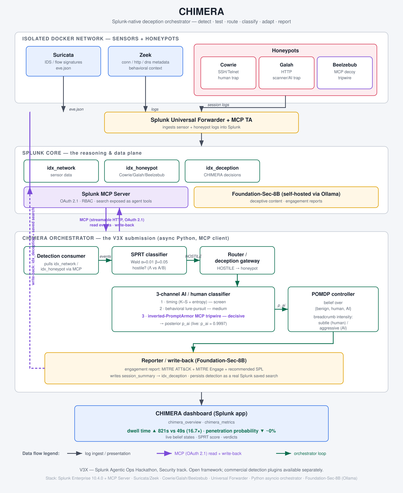

# CHIMERA

**A Splunk-native AI deception agent that detects an intruder with a *provable* error bound, figures out whether it's facing a human or an autonomous AI agent, and adapts its honeypot deception to waste each one's time — while keeping the chance of a real breach near zero.**

Built for the **Splunk Agentic Ops Hackathon — Security track**.



---

## The problem

Security teams are drowning in alerts, and a new attacker just showed up: the autonomous AI agent. Palisade Research's *LLM Agent Honeypot* showed they're already probing the public internet; Cisco Talos is tracking the threat. Splunk shipped six SOC agents that **detect and respond** — none of them **deceive**. CHIMERA fills that empty space: it turns the honeypot into an adaptive, AI-aware deception engine driven entirely from Splunk data.

## What's different

- **Provable detection, not a black-box score.** A Wald **Sequential Probability Ratio Test (SPRT)** declares HOSTILE with bounded false-positive (α=0.01) and false-negative (β=0.05) rates. (Live: Λ=5.7 → HOSTILE.)
- **Human-vs-AI classification** across three channels — and the standout is an **inverted-PromptArmor MCP tripwire**: a Beelzebub MCP decoy exposes a tool no human would ever call. An LLM agent calls it and fingerprints itself. (Live: classified **AI at p_ai = 0.9997**.)
- **Adaptive deception** via a POMDP belief controller: aggressive looping breadcrumbs for an AI that'll chase a planted goal, sparse and subtle ones for a human who'd get suspicious.
- **It leaves a durable artifact.** Foundation-Sec-8B writes the engagement report (real MITRE ATT&CK + MITRE Engage IDs + a recommended SPL detection), which CHIMERA **persists as a real Splunk saved search** — not just a summary, an action.
- **The whole loop runs through the Splunk MCP Server** — read path and detection write-back — and the tripwire is *itself* an MCP decoy.

## Impact (live dashboard)

| Metric | Static honeypot | With CHIMERA |
|---|---|---|
| Attacker dwell time | ≈ 49 s | ≈ 821 s (**16.7×**) |
| Penetration probability | — | **~0%** |

## Prize tracks claimed

1. **Grand Prize** — a novel deception wedge with provable-error math and quantified dwell/penetration impact.
2. **Best of Security** — blue-team deception mapped to MITRE **Engage** + **ATT&CK**.
3. **Best Use of MCP Server** — the orchestrator is an MCP client; read + write-back go through MCP; the tripwire is an MCP decoy.
4. **Best Use of Hosted Models** — self-hosted **Foundation-Sec-8B** (via Ollama) doing real analyst work.

## The agent loop

```
detect → SPRT test → route → classify (human vs AI) → adapt (POMDP) → Foundation-Sec report → write-back
```

Sensors (Suricata/Zeek) and honeypots (Cowrie/Galah/Beelzebub) feed Splunk via a Universal Forwarder. The async Python orchestrator reads those indexes through the Splunk MCP Server, runs the math below, and writes its decisions back to `idx_deception` and the Splunk saved-search store. See **[ARCHITECTURE.md](ARCHITECTURE.md)** for the full writeup.

## The math (named methods, not freeform LLM)

- **SPRT (Wald).** Each event adds a per-type log-likelihood ratio; when Λ crosses the upper Wald bound `A = ln((1−β)/α)` → **HOSTILE**, below `B = ln(β/(1−α))` → **BENIGN**, with provable α/β error bounds. Verdicts are sticky per `src_ip`. *(Mandatory.)*
- **3-channel AI/human classifier.** (1) **Timing** — Kolmogorov–Smirnov test + Shannon entropy on inter-command intervals; (2) **Behavioral** — lure-pursuit divergence; (3) **MCP tripwire** — the inverted-PromptArmor Beelzebub decoy. Channels fuse into `p_ai`. *(Mandatory.)*
- **POMDP belief controller.** Belief over `{benign, human, AI}` on the simplex, Bayesian-updated from SPRT verdicts and the classifier posterior; a hand-tuned threshold policy (0.7) picks breadcrumb intensity `{none, subtle, moderate, aggressive}`. *(Simplified for v1: action recorded, not yet physically actuated.)*
- **Bayesian signaling game.** The unifying narrative frame and the MITRE Engage/ATT&CK mapping (e.g. EAC0005 Lures, EAC0016 Network Manipulation).

## Quickstart

> Prereqs: a running **Splunk Enterprise 10.4** with the **Splunk MCP Server** app, Docker + Docker Compose, **[uv](https://docs.astral.sh/uv/)**, and **Ollama** serving Foundation-Sec-8B. See [ARCHITECTURE.md](ARCHITECTURE.md) for the full stack.

```bash
# 1. Configure (real secrets live only in .env, which is gitignored)
cp .env.example .env
$EDITOR .env                     # fill SPLUNK_ADMIN_PASSWORD, SPLUNK_MCP_TOKEN, ...

# 2. Bring up the isolated honeypot/sensor stack (chimera_dmz docker net)
docker compose -f infra/docker-compose.yml up -d

# 3. (host) Install the Universal Forwarder to ship honeypot logs into Splunk
sudo bash scripts/install_uf.sh

# 4. Run the orchestrator loop
cd orchestrator && uv sync && uv run python -m chimera.loop

# 5. Drive an attacker (in another shell): human SSH vs autonomous AI agent
bash   scripts/seed_attacker.sh        # human-paced SSH attacker
python scripts/seed_ai_attacker.py     # fast, goal-directed LLM agent

# 6. Open the CHIMERA dashboard in Splunk Web:
#    Apps → CHIMERA → "chimera_overview" (live loop) and "chimera_metrics" (the money chart)
```

## Demo video

▶ **[Watch the demo](https://www.youtube.com/watch?v=i3tzNBW3Vyo)**

A walkthrough (human vs AI against the same honeypot, the SPRT bound crossing, the MCP tripwire firing, and the dwell-time money chart). See [`demo/demo_script.md`](demo/demo_script.md) and [`demo/recording_notes.md`](demo/recording_notes.md).

## Repository layout

| Path | What |
|---|---|
| `orchestrator/` | The submission — async Python MCP-client agent (SPRT, classifier, POMDP, reporter, write-back). 135 tests pass. |
| `infra/` | Docker Compose stack: Suricata, Cowrie, Galah, Beelzebub + forwarder config. |
| `splunk-app/` | CHIMERA Splunk app: indexes, saved searches, `chimera_overview` / `chimera_metrics` dashboards. |
| `scripts/` | UF installer, attacker seeds, smoke test, demo seeder. |
| `demo/` | Architecture diagram, demo script, recording notes. |

## License & attribution

**MIT** — see [LICENSE](LICENSE).

**Open-core notice.** This repository is the open-source orchestration framework. Detection plugins integrate via the documented backend interface in `orchestrator/chimera/`. No proprietary code is included here.

## Prior art (honest credits)

CHIMERA stands on the shoulders of existing work and is explicit about what it **uses or inverts** versus what is novel here:

- **Cowrie**, **Galah**, **Beelzebub** — third-party honeypots we deploy as-is (Galah and Beelzebub use LLMs for deceptive responses; Beelzebub provides the MCP decoy surface).
- **Palisade Research — LLM Agent Honeypot** — prior art that demonstrated AI agents probe the internet; CHIMERA builds on that observation.
- **PromptArmor** — a prompt-injection *defense* for agents; CHIMERA runs the idea **backwards** as an MCP tripwire **sensor**. We did not invent PromptArmor.
- **Foundation-Sec-8B** (Cisco/Foundation AI) — the hosted security model we self-host via Ollama.

What is novel here is the **composition**: a Splunk-native, MCP-wired loop that joins provable SPRT detection, AI-vs-human classification (with the inverted-tripwire wedge), and POMDP-driven adaptive deception into one closed loop that produces a durable, actionable Splunk artifact.
